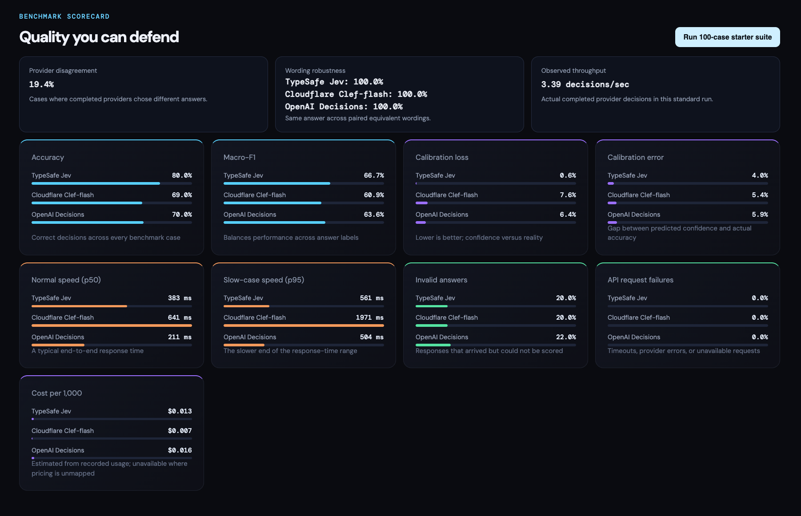

# DecisionLens 🔎

**See the trade-offs behind every answer.**

DecisionLens runs the same decision tasks across TypeSafe Jev, Cloudflare Clef-flash, and OpenAI Decisions. Compare answer quality, confidence, response time, estimated cost, and consistency in one dashboard.

[Quick start](#quick-start) · [Dashboard](#dashboard) · [Metrics](#what-we-measure) · [API](#api-reference)

DecisionLens is independent and not affiliated with TypeSafe, Cloudflare, or OpenAI.

## What is a System One Model?

DecisionLens evaluates systems that turn shared evidence into a bounded, machine-readable decision rather than open-ended generated text. A request supplies evidence plus a typed question, then receives a probability for a predicate, a selection from fixed choices, or a score against ordered levels.

“System One Model” is TypeSafe’s term for models optimized for fast, structured, probabilistic decisions in software. It is not a general label for every provider in this repository. [TypeSafe’s Jev announcement](https://typesafe.ai/blog/introducing-system-one-models-and-jev)

## Providers in this benchmark

### TypeSafe Jev

Jev is TypeSafe’s public System One Model. Its `/v1/systemone` API accepts shared state and named typed questions, then returns decisions for yes/no predicates, fixed choices, and ordered scores, together with token usage. [Jev API reference](https://api.typesafe.ai/redoc)

### Cloudflare Clef-flash

Clef-flash is Cloudflare’s hosted 9B multimodal decision model. It accepts text, structured JSON, images, or video and returns typed answers with probabilities for the permitted options. DecisionLens uses its Workers AI REST endpoint. [Cloudflare model documentation](https://developers.cloudflare.com/ai/models/%40cf/cloudflare/clef-flash/)

### OpenAI Decisions

OpenAI Decisions is a dedicated API for typed predicate, choice, and score answers over text and image input. It currently uses `gpt-6-luna` and is documented as a public beta API. [OpenAI Decisions guide](https://developers.openai.com/api/docs/guides/decisions)

## Dashboard

### Benchmark scorecard



Compare providers side by side across quality, latency, and estimated cost. Screenshots capture individual development runs; their values are examples, not general provider rankings.

### Live provider comparison


Try a single scenario and inspect each provider’s answer, confidence, and response time.

## What you can do

- FastAPI API with provider availability reporting and `POST /api/v1/compare`.
- Isolated adapters for Jev, Clef-flash, and OpenAI Decisions.
- Safe server-side environment configuration; credentials never reach the browser.
- Next.js dashboard with a live comparison workbench and benchmark scorecards.
- A 100-case starter suite across binary, choice, ordinal, ambiguity, invariance, and paired wording tests.
- In-memory benchmark jobs with accuracy, macro-F1, categorical Brier loss, expected calibration error, p50/p95 latency, invalid and API-failure rates, cost estimates, disagreement, robustness, and observed throughput.
- Provider and API validation tests that do not make paid external calls.

## What we measure

| Metric | What it tells you |
| --- | --- |
| Accuracy and macro-F1 | How answers compare with the dataset’s expected labels |
| Brier loss and calibration error | How well predicted probabilities match observed outcomes |
| p50 / p95 latency | Typical and slower response times, including network overhead |
| Invalid answers and API failures | Whether responses can be scored and requests complete successfully |
| Estimated cost per 1,000 decisions | Token usage multiplied by the configured provider rates |
| Provider disagreement | How often providers choose different answers on comparable cases |
| Wording robustness | Whether paired versions of a scenario receive the same answer |
| Observed throughput | Completed provider decisions per second during the run |

The starter suite contains **100 cases**: 50 binary, 30 choice, and 20 ordinal tasks. Running all three providers produces **300 provider evaluations**. Cases cover arithmetic, rules, support routing, ambiguity, severity, and five equivalent-wording pairs.

## Quick start

You’ll need Python 3.12+, [uv](https://docs.astral.sh/uv/), a Node.js version supported by Next.js 15, npm, and credentials for at least one provider.

### 1. Configure providers

Copy the example file, then supply only the providers you want to use:

```bash
cp .env.example .env
```

| Provider | Required configuration |
| --- | --- |
| TypeSafe Jev | `TYPESAFE_API_KEY` |
| Cloudflare Clef-flash | `CLOUDFLARE_ACCOUNT_ID`, `CLOUDFLARE_API_TOKEN` |
| OpenAI Decisions | `OPENAI_API_KEY`, `OPENAI_DECISIONS_ENABLED=true` |

Keep `.env` in the repository root. Credentials are read by the backend; do not place them in public frontend environment variables.

### 2. Start the backend

```bash
cd backend
uv sync --group dev
uv run uvicorn app.main:app --reload --port 8000
```

### 3. Start the frontend

In a second terminal, from the repository root:

```bash
cd frontend
npm install
npm run dev
```

Open the [dashboard](http://localhost:3000). Interactive [API documentation](http://localhost:8000/docs) is also available.

### 4. Run a comparison

- Use **Compare 3 providers** in the decision workbench to try the configured providers on one scenario.
- Select **Run 100-case starter suite** to populate the benchmark scorecards. This makes billable requests to the selected providers.
- To use your own labelled dataset, upload a JSONL file through `POST /api/v1/datasets/upload`, then pass its ID to `POST /api/v1/benchmarks/run`.

## Development checks

From the repository root:

```bash
make api-test
make api-lint
npm --prefix frontend run lint
cd frontend && npx tsc --noEmit
```

The backend tests use local fixtures and do not make paid provider calls.

## API reference

```text
GET  /health
GET  /api/v1/providers
POST /api/v1/compare
GET  /api/v1/datasets
POST /api/v1/datasets/upload
POST /api/v1/benchmarks/run
GET  /api/v1/benchmarks/{run_id}
```

## Project layout

```text
backend/       FastAPI routes, provider adapters, configuration, and tests
frontend/      Next.js dashboard and server-side API proxies
fixtures/      Versioned benchmark datasets
media/         README screenshots
```

The repository separates the backend and frontend; backend application modules live under `backend/app/`.

## Current limitations

- Benchmark jobs and uploaded datasets live in memory. Restarting the backend clears them.
- Providers run concurrently within each case; cases run sequentially. Observed throughput does not measure maximum concurrency capacity.
- The starter suite is a small synthetic evaluation, not a comprehensive fairness or reliability assessment.
- Cost figures are estimates from configured rates and recorded usage, not billing receipts.
- Persistent storage, a detailed result explorer, and controlled concurrency tests remain planned work.

## License

This project is licensed under the [MIT License](LICENSE).

You are free to use, modify, and distribute this software under the terms of
the license. Keep the license and copyright notice with substantial copies of
the project.

## Author

Krish Batra

- Website: [vybecode.in](https://vybecode.in)
- Email: [krishbatra3@gmail.com](mailto:krishbatra3@gmail.com)
- LinkedIn: krish-batra

