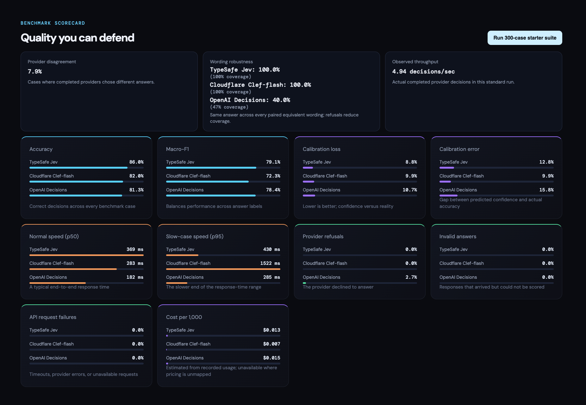
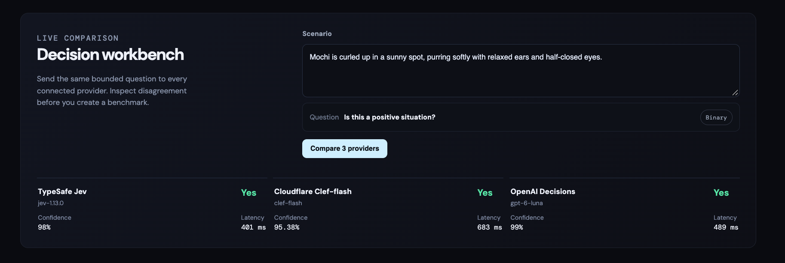

# DecisionLens

**See the trade-offs behind every answer.**

DecisionLens runs the same decision tasks across TypeSafe Jev, Cloudflare Clef-flash, and OpenAI Decisions. Compare answer quality, confidence, response time, estimated cost, and consistency in one dashboard.

[Results](#benchmark-results) · [Live comparison](#dashboard) · [Quick start](#quick-start) · [More details](#more-details)



## Benchmark results

**300 cases · 3 providers · 900 provider evaluations**

Recorded from a live API run. These numbers match the saved scorecard above and reflect that run’s scoring implementation.

**Recorded run at a glance**

- **TypeSafe Jev** → 86.0% accuracy, 369 ms p50, ~$0.013 per 1K decisions
- **Cloudflare Clef-flash** → 82.0% accuracy, 283 ms p50, ~$0.007 per 1K decisions
- **OpenAI Decisions** → 81.3% accuracy, 182 ms p50, ~$0.015 per 1K decisions

| Metric | TypeSafe Jev | Cloudflare Clef-flash | OpenAI Decisions |
| --- | ---: | ---: | ---: |
| Accuracy | 86.0% | 82.0% | 81.3% |
| Macro-F1 | 79.1% | 72.3% | 78.4% |
| Calibration loss (as displayed) | 8.8% | 9.9% | 10.7% |
| Calibration error | 12.8% | 9.9% | 15.8% |
| p50 latency | 369 ms | 283 ms | 182 ms |
| p95 latency | 430 ms | 1,522 ms | 285 ms |
| Provider refusals | 0.0% | 0.0% | 2.7% |
| Invalid answers | 0.0% | 0.0% | 0.0% |
| API request failures | 0.0% | 0.0% | 0.0% |
| Wording robustness | 100.0% (100% coverage) | 100.0% (100% coverage) | 40.0% (47% coverage) |
| Estimated cost per 1,000 decisions | $0.013 | $0.007 | $0.015 |

- **Provider disagreement:** 7.9% of comparable cases.
- **Observed throughput:** 4.94 provider decisions per second across the run.

In this run: **Jev led on accuracy**, **OpenAI Decisions on latency**, and **Clef-flash on estimated cost**. OpenAI Decisions declined 2.7% of cases, which reduces its wording-robustness coverage.

## Dashboard

Try one scenario. Compare each provider’s answer, confidence, and response time side by side.



## Quick start

You’ll need Python 3.12+, [uv](https://docs.astral.sh/uv/), a Node.js version supported by Next.js 15, npm, and credentials for at least one provider.

### 1. Configure providers

Copy the example file, then supply only the providers you want to use:

```bash
cp .env.example .env
```

| Provider | Required configuration |
| --- | --- |
| TypeSafe Jev | `TYPESAFE_API_KEY` |
| Cloudflare Clef-flash | `CLOUDFLARE_ACCOUNT_ID`, `CLOUDFLARE_API_TOKEN` |
| OpenAI Decisions | `OPENAI_API_KEY`, `OPENAI_DECISIONS_ENABLED=true` |

Keep `.env` in the repository root. Credentials are read by the backend; do not place them in public frontend environment variables.

### 2. Start the backend

```bash
cd backend
uv sync --group dev
uv run uvicorn app.main:app --reload --port 8000
```

### 3. Start the frontend

In a second terminal, from the repository root:

```bash
cd frontend
npm install
npm run dev
```

Open the [dashboard](http://localhost:3000). Interactive [API documentation](http://localhost:8000/docs) is also available.

### 4. Run a comparison

- Use **Compare 3 providers** in the decision workbench to try the configured providers on one scenario.
- Select **Run 300-case starter suite** to populate the benchmark scorecards. This makes billable requests to the selected providers.

## More details

<details>
<summary><strong>System One models and the three providers</strong></summary>

DecisionLens compares bounded decisions: yes/no answers, selections from fixed choices, and scores against ordered levels—not open-ended generated text.

“System One Model” is TypeSafe’s term for models built for fast, structured, probabilistic decisions. It is not a general label for all three providers. [TypeSafe’s introduction](https://typesafe.ai/blog/introducing-system-one-models-and-jev)

| Provider | What it is | Reference |
| --- | --- | --- |
| TypeSafe Jev | TypeSafe’s public System One Model. Its `/v1/systemone` API accepts shared state and typed questions, returning decisions and token usage. | [API reference](https://api.typesafe.ai/redoc) |
| Cloudflare Clef-flash | A hosted 9B multimodal decision model that returns typed answers and option probabilities. DecisionLens calls it through Workers AI. | [Model documentation](https://developers.cloudflare.com/ai/models/%40cf/cloudflare/clef-flash/) |
| OpenAI Decisions | A public beta API for predicate, choice, and score answers over text and images, using `gpt-6-luna`. | [Decisions guide](https://developers.openai.com/api/docs/guides/decisions) |

DecisionLens is independent and not affiliated with TypeSafe, Cloudflare, or OpenAI.

</details>

<details>
<summary><strong>Metrics and the starter dataset</strong></summary>

| Metric | What it tells you |
| --- | --- |
| Accuracy and macro-F1 | How answers compare with the dataset’s expected labels |
| Brier loss and calibration error | How well predicted probabilities match observed outcomes |
| p50 / p95 latency | Typical and slower response times, including network overhead |
| Invalid answers and API failures | Whether responses can be scored and requests complete successfully |
| Estimated cost per 1,000 decisions | Token usage multiplied by the configured provider rates |
| Provider disagreement | How often providers choose different answers on comparable cases |
| Wording robustness | Whether paired versions of a scenario receive the same answer |
| Observed throughput | Completed provider decisions per second during the run |

The default v2 starter suite has **150 binary, 90 choice, and 60 ordinal cases** across ten domains, including arithmetic, rules, boundaries, routing, invariance, robustness, incident severity, and risk assessment.

Running all three providers produces **900 provider evaluations**, not 900 unique cases. The original 100-case v1 suite remains available for reproducible earlier runs.

</details>

<details>
<summary><strong>API reference and custom datasets</strong></summary>

Upload a labelled JSONL file through `POST /api/v1/datasets/upload`. Pass the returned dataset ID to `POST /api/v1/benchmarks/run`.

```text
GET  /health
GET  /api/v1/providers
POST /api/v1/compare
GET  /api/v1/datasets
POST /api/v1/datasets/upload
POST /api/v1/benchmarks/run
GET  /api/v1/benchmarks/{run_id}
```

With the backend running, open the [interactive API documentation](http://localhost:8000/docs) for request schemas.

</details>

<details>
<summary><strong>Development checks and project layout</strong></summary>

### Development checks

From the repository root:

```bash
make api-test
make api-lint
npm --prefix frontend run lint
cd frontend && npx tsc --noEmit
```

The backend tests use local fixtures and do not make paid provider calls.

### Project layout

```text
backend/       FastAPI routes, provider adapters, configuration, and tests
frontend/      Next.js dashboard and server-side API proxies
fixtures/      Versioned benchmark datasets
media/         README screenshots
```

The repository separates the backend and frontend; backend application modules live under `backend/app/`.

FastAPI handles provider adapters and in-memory benchmark jobs. Next.js provides the dashboard and server-side API proxies. Credentials stay on the server.

</details>

## License

This project is licensed under the [MIT License](LICENSE).

You are free to use, modify, and distribute this software under the terms of
the license. Keep the license and copyright notice with substantial copies of
the project.

## Author

Krish Batra

- Website: [vybecode.in](https://vybecode.in)
- Email: [krishbatra3@gmail.com](mailto:krishbatra3@gmail.com)
- LinkedIn: krish-batra

